# PharmaCore

Pharmacy management and point-of-sale system for independent pharmacies in Lebanon. It runs on **one
workstation, fully offline**, in the browser: fast checkout with USD/LBP, batch and expiry tracking, returns,
reports, backups, role-based access, and an optional AI business assistant that only works with real
PharmaCore data.

> Status: **pilot**. Suitable for a supervised pilot in one pharmacy. See [Known limitations](#known-limitations).

## Features

**Point of sale**
- Barcode scan or search (name, MoPH code, barcode), cart, quantity limits from live stock
- Prices always come from the catalog on the server; only owners may override a price (audited)
- Discounts (pharmacist/owner only), payment in USD, LBP or mixed, change calculation, browser receipt printing
- Stock deducted first-expiry-first-out (FEFO) across batches, inside one database transaction
- **Expired batches are never sold** (and cannot be received); POS stock counts only unexpired units
- **Hold a sale** while serving another customer and resume it later (kept on the server, visible to the next shift)

**Cash drawer**
- Open a shift with a USD + LBP float; sales and refunds are blocked while the drawer is closed
- Pay-ins / pay-outs with a reason (audited)
- Close with a **blind count**: cashiers enter what they counted without seeing the expected amount;
  pharmacists and the owner see expected vs counted per currency, the difference, and shift history
- Printable shift (Z) report

**Inventory**
- Receive stock by batch with expiry and cost; full MoPH catalog import (~10k products)
- Stock adjustments with a reason (damaged, expired, count correction, …) and a movement history
- Expiry colouring, low-stock and out-of-stock lists that ignore never-stocked catalog items

**Sales & returns**
- Sales history with reprint; returns put stock back and refund the *discounted* share of each line

**Reports**
- Sales summary (net of discounts and refunds), daily revenue chart, top products, low stock, expiring
  batches, stock movements, profit with cost coverage (owner), inventory valuation; CSV export and print

**Users & security**
- Roles: **owner**, **pharmacist**, **cashier**, enforced on every API route (not just hidden in the UI)
- User management (owner), password change/reset, login throttling, disabling a user ends their session
- Audit log on sales, returns, stock changes, price overrides, settings, users, backups and imports

**Reliability**
- SQLite with WAL; **automatic daily backups** with retention, optional copy to a second location
  (USB / external drive), backup-age warnings on the dashboard
- Restore validates the file and keeps a safety copy first

**AI business assistant** (optional, see [AI assistant](#ai-assistant))
- Ask questions ("What sold best this month?"), **✨ Analyze business**, natural-language smart search
- Permission-aware, grounded in backend tools, logged; never gives clinical advice

## Role permissions

| Capability | Cashier | Pharmacist | Owner |
|---|:-:|:-:|:-:|
| Sell, hold sales, open/close the drawer (blind count), pay-ins/outs, view sales, look up stock, link barcodes, inventory reports, AI assistant | ✓ | ✓ | ✓ |
| Discounts, returns, manage products, receive/adjust stock, sales reports, cash reconciliation & shift history, exchange rate, create backups | | ✓ | ✓ |
| Price override, profit reports, pharmacy settings/profile, users, restore backups, MoPH import, AI logs | | | ✓ |

Source of truth: `server/src/auth/permissions.ts`. The user's role is re-read from the database on every request.

## Stack

| Layer | Technology |
|---|---|
| Client | React 19, Vite 6, Tailwind CSS 4, React Router 7 |
| Server | Node.js, Express 4, TypeScript (ESM), Zod validation, JWT auth, bcrypt |
| Database | SQLite via better-sqlite3 (WAL mode) |
| Tests | Node's built-in test runner + tsx, in-memory SQLite |
| AI (optional) | Any OpenAI-compatible Chat Completions API (OpenAI, Ollama, LM Studio) via built-in `fetch` |

SQLite is deliberate: one pharmacy, one PC, no network dependency, trivial backups (a single file).

## Architecture

```
Pharma/
├── client/                 React SPA
│   └── src/
│       ├── pages/          One page per screen (POS, Inventory, Reports, Assistant, Users, …)
│       ├── components/     Layout, design-system primitives (ui.tsx), icons, assistant panels
│       ├── context/        Auth (user, permissions, can()), settings
│       └── lib/            API client + types, CSV export, receipt template, safe markdown
├── server/
│   ├── src/
│   │   ├── app.ts          Express app factory (used by index.ts and the tests)
│   │   ├── config.ts       Environment configuration
│   │   ├── auth/           Permission matrix
│   │   ├── middleware/     requireAuth / requirePermission
│   │   ├── routes/         HTTP layer: validation + permission checks
│   │   ├── services/       Business logic: checkout, stock, reports, structured queries, dates
│   │   ├── ai/             Provider, tools, orchestrator, insights, NL search, prompts, logging
│   │   └── db/             Connection, migrations, seed
│   ├── tests/              API + unit tests
│   └── data/               pharmacore.db and backups/ (git-ignored)
├── docs/                   SCHEMA.md, TESTING.md, MOPH.md
└── scripts/                Dev helpers, legacy live smoke test
```

Business rules (prices, discounts, stock, refunds, permissions) live on the server. The client hides
controls the user cannot use, but the API rejects them regardless.

### AI assistant flow

```
User question ─► POST /api/ai/chat ─► orchestrator
                                       │  system prompt: date, rules, which tools this role lacks
                                       ▼
                         LLM (tool calling, max 5 rounds)
                                       │ tool call {name, args}
                                       ▼
          executeTool: role allowed? ─► Zod-validate args ─► fixed SQL in services/reports.ts
                                       │ JSON result (size-capped)
                                       ▼
                         LLM writes the answer ─► { answer, tool_calls, grounded } ─► ai_logs
```

- The model **never sees SQL or the database**; it can only call the 11 tools in `server/src/ai/tools.ts`.
- Tools a role cannot use are not offered, and are refused if called anyway.
- **Smart search**: the model produces a structured query (`entity` + filters); it is validated against a
  strict schema, permission-checked, then run with parameterised SQL. Invalid output → 422, never guessed.
- **Analyze business**: highlights are computed deterministically from real data; the AI only adds a narrative.
  If the AI is down, the data and highlights are still shown.
- Every request, tool call, status and error is stored in `ai_logs` (owner can read via `GET /api/ai/logs`).
- The prompt forbids clinical decisions (safety, dosing, interactions); those go to the pharmacist.

## Installation

Requirements: **Node.js 22 LTS or newer** (tested on Node 24), Windows/macOS/Linux.

```bash
cd Pharma
npm install
copy .env.example .env     # macOS/Linux: cp .env.example .env
npm run dev
```

- Web UI: http://localhost:5173 · API: http://localhost:4000
- First run creates the database and an **owner** account `admin` with the password from
  `INITIAL_ADMIN_PASSWORD` (default `admin123`). **Change it immediately** under *My account* (click your name in the sidebar).

If the API crashes with `better_sqlite3` / `NODE_MODULE_VERSION` after a Node upgrade: `npm run fix:native`.

## Configuration

All settings are environment variables, read from `.env` in the repo root or `server/`. See
[`.env.example`](.env.example).

| Variable | Default | Purpose |
|---|---|---|
| `JWT_SECRET` | dev secret | **Required in production** — the server refuses to start without it |
| `PORT` | `4000` | API port |
| `JWT_EXPIRES_IN` | `12h` | Session length |
| `PHARMACORE_DATA_DIR` | `server/data` | Database and backups folder |
| `INITIAL_ADMIN_PASSWORD` | `admin123` | Only used when the database is first created |
| `AI_BASE_URL` / `AI_API_KEY` / `AI_MODEL` | — | Enables the assistant (`AI_MODEL` required; key optional for localhost) |
| `AI_TIMEOUT_MS`, `AI_MAX_TOOL_ROUNDS`, `AI_RATE_LIMIT`, `AI_RATE_WINDOW_MS` | 45000, 5, 30, 300000 | Assistant limits |

Exchange rate, address and receipt footer are set in the app (**Settings**); pharmacy name, pharmacist and
licence numbers under **Pharmacy profile**.

## Database

SQLite file at `server/data/pharmacore.db`, created and migrated automatically on startup (migrations are
additive and idempotent — existing data is preserved). Schema: [`docs/SCHEMA.md`](docs/SCHEMA.md).
MoPH catalog import: [`docs/MOPH.md`](docs/MOPH.md).

Backups go to `server/data/backups/`:

- **Automatic**: while the server runs it checks hourly and makes an `auto-*.db` backup when the newest
  backup is 24 h old; the newest 14 (configurable) are kept.
- **Manual**: *Back up now* on the Backup page (`POST /api/backup/create`).
- **Second location** (owner, Backup page): a folder on a USB stick or another drive. Every backup is copied
  there; failures show on the Backup page and the dashboard.

Restoring (owner only) validates the file, saves a safety copy of the current data, then requires a server
restart.

## Daily routine

1. **Open the drawer** (Cash drawer → count the float → *Open shift*). Selling is blocked until then.
2. Sell. Use **Hold sale** to park a customer's cart; resume it from **Held sales**.
3. Record cash taken out (supplier, delivery) or added as **pay-outs / pay-ins**.
4. At the end of the shift, **Count & close shift**. Owner/pharmacist review the difference and print the report.
5. Check the dashboard for expiry, low-stock and backup warnings.

## Running in production

```bash
npm run build
set NODE_ENV=production
set JWT_SECRET=<long random string>
npm start
```

The server serves the built client from `client/dist` at http://localhost:4000.

## Testing

```bash
npm test           # 87 automated tests, in-memory database, no network
npm run typecheck
```

What is covered and the manual checklist: [`docs/TESTING.md`](docs/TESTING.md).

## Screenshots

Demo data on a copy of the MoPH catalogue. The interface has Light, Dark and System themes (switch in the top bar);
the visual system is described in [`docs/DESIGN.md`](docs/DESIGN.md).

Point of sale, cashier signed in: last-added line marked, graphite checkout column with the total and change

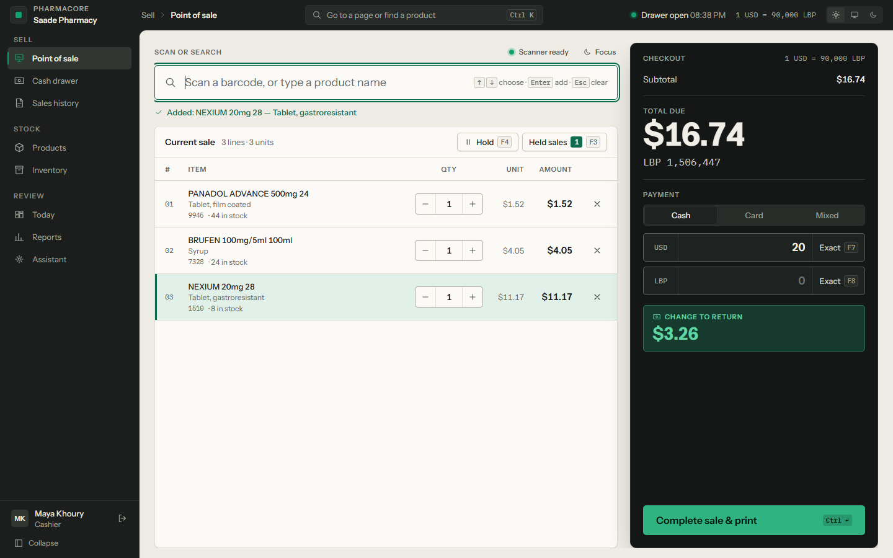

The same sale in the dark theme, and in the optional Focus mode (dark POS workspace inside the light theme)

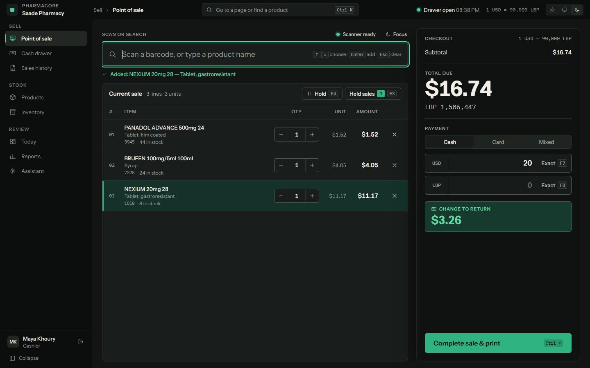
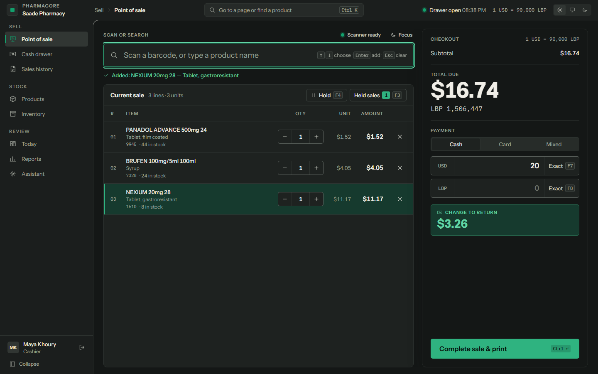

POS on a 1024 px tablet while searching; out-of-stock products are shown as not sellable

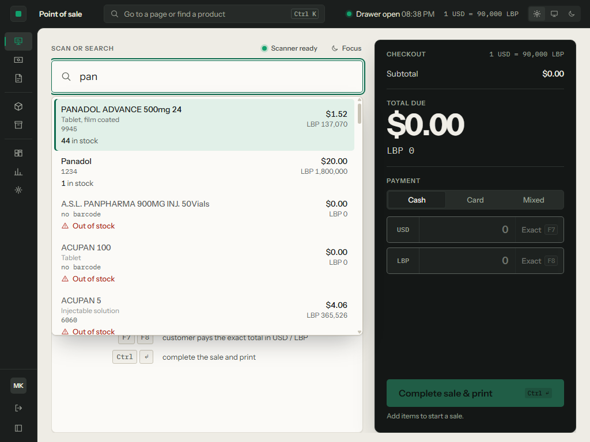

Today: takings, the three shelf checks and the last 7 days of revenue

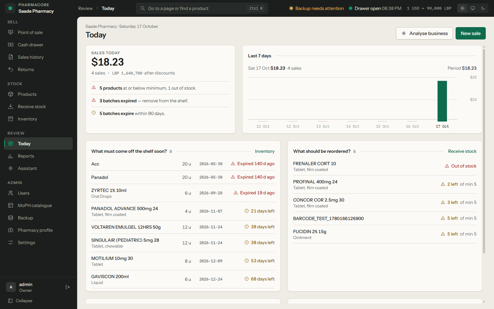

Product inspector: price, stock, identity and batches with expiry, opened from the catalogue, Inventory or Ctrl K

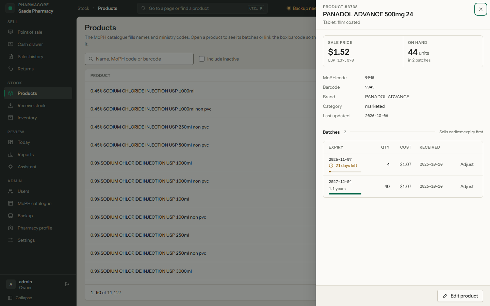
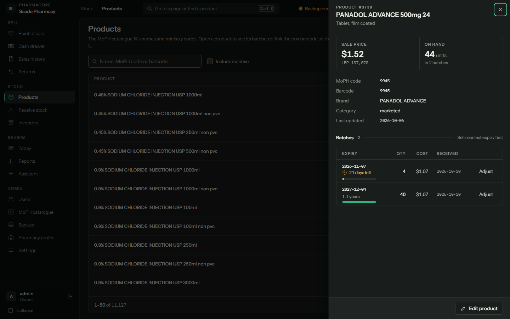

Inventory by batch with shelf-life meters; Receive stock with one-step product search

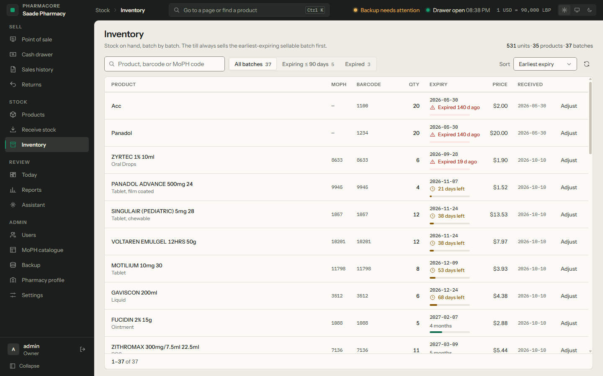
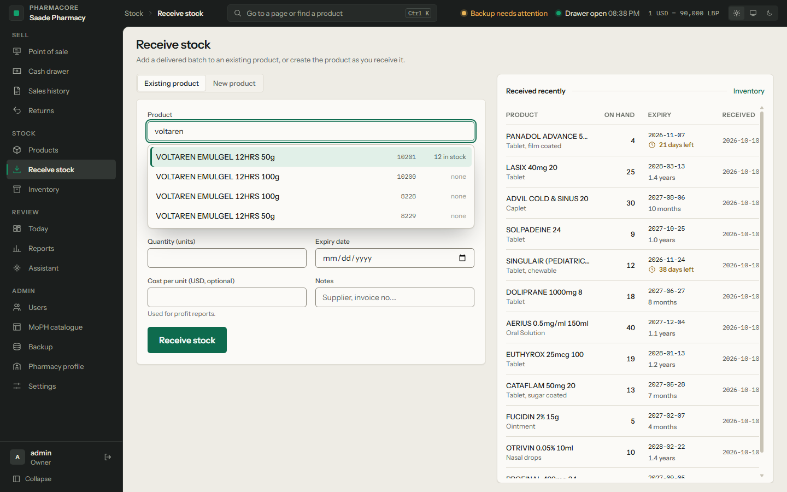

Reports for the last 30 days, light and dark

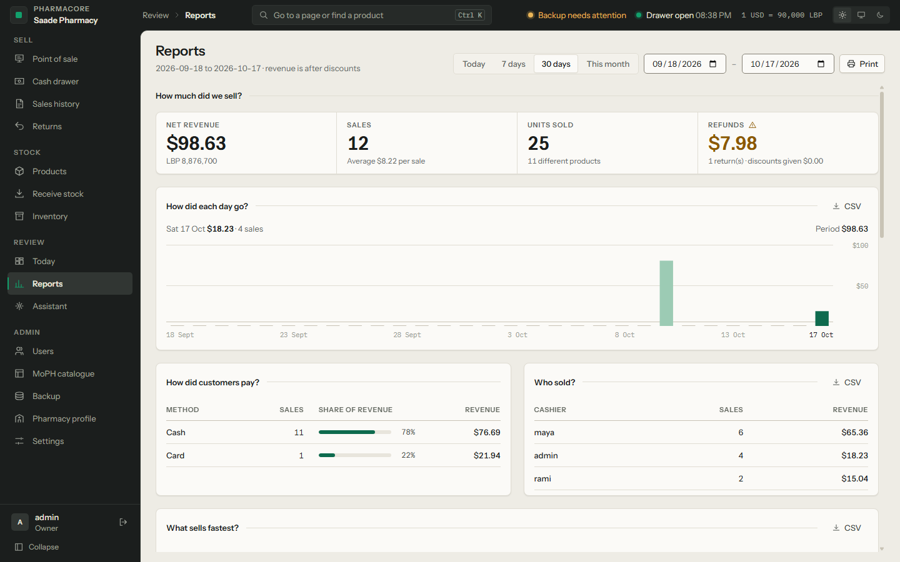
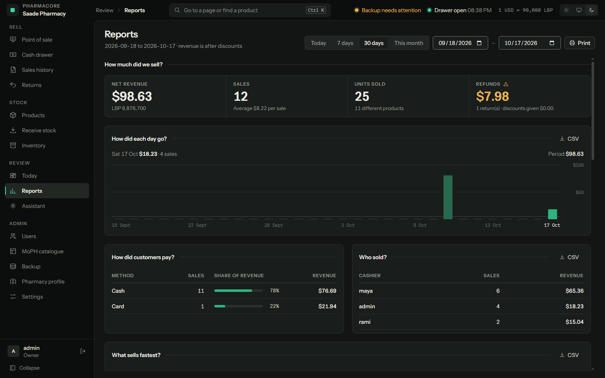

Cash drawer, owner view, and the cashier's blind-count view of the same shift

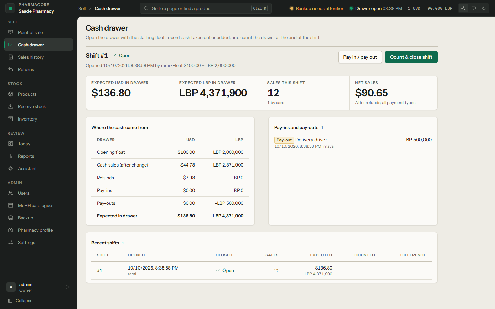
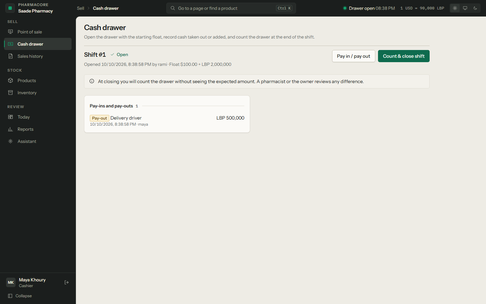

Backups (dark theme) and sign in

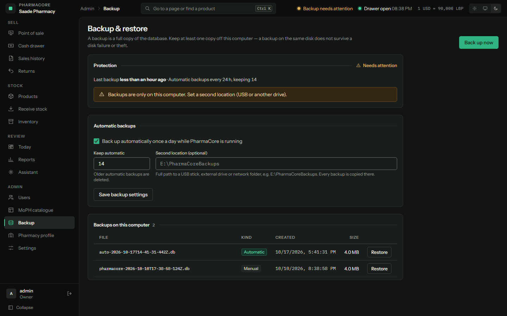
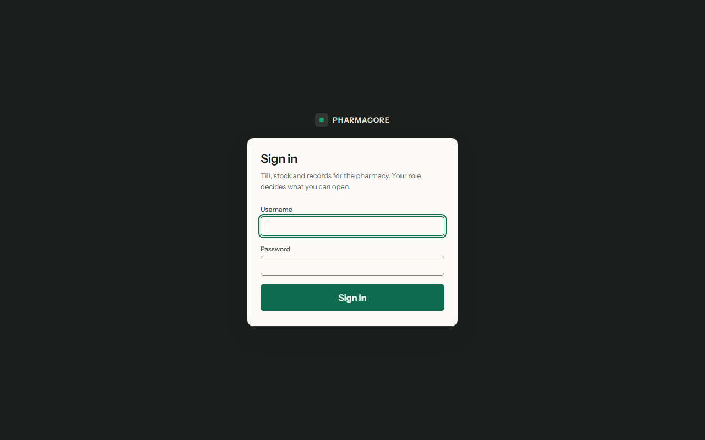

## Known limitations

- **No customers / prescriptions** module yet, so there is no customer summary (AI or reports).
- **No suppliers / purchase orders**; stock is received manually or via MoPH catalog data.
- **One cash drawer**: one open shift at a time. Card payments are not split from cash inside a single
  sale ("mixed" means USD + LBP cash). Held sales do not reserve stock.
- **Receipts and shift reports** print through the browser dialog; no direct ESC/POS thermal printer driver.
- **Single workstation**: no multi-terminal sync; SQLite is not meant for concurrent PCs over a network share.
- **Automatic backups run only while the server is running**; the second-location copy needs the drive connected.
- Low-stock and valuation reports count expired units as stock until they are written off (POS does not sell them).
- **Login throttling and AI rate limits are in memory** and reset when the server restarts.
- The AI assistant needs an external or local LLM with tool calling; answer quality depends on the model.
- UI is in English only (product names may be Arabic); no Arabic/RTL interface yet.
- Automated tests cover the API and business logic; there are **no automated browser (E2E) tests**.

## Roadmap

1. Suppliers and purchase orders; receive against a PO; supplier returns for expired stock
2. Customers (optional) with purchase history → enables `get_customer_summary` for the assistant
3. Split card + cash payments within one sale
4. Direct thermal printer support; Electron wrapper / Windows service so backups run at boot
5. Arabic / RTL interface
6. Playwright end-to-end tests for POS, returns and the cash drawer

## Notes for Lebanon

- Prices are stored in **USD**; LBP is derived from the exchange rate in Settings.
- Each sale stores the rate used at checkout, so past receipts and refunds stay correct after rate changes.
