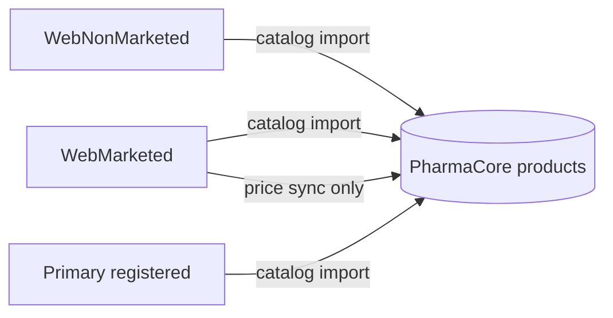

# MoPH data sources (Lebanon)

PharmaCore uses **three official Excel files** from the [Drugs Public Price List](https://moph.gov.lb/en/Pages/3/3101/drugs-public-price-list-) page, plus a separate **price-sync** step when MoPH publishes updates.

## The three catalog files (example: 20260505)

| File | Role | Rows (approx.) | MoPH Code | Public price LBP |
|------|------|----------------|-----------|------------------|
| **WebMarketed** `.xls` | Marketed drugs with official prices | ~5,589 | Yes | Yes |
| **WebNonMarketed** `.xls` | Registered but not marketed | ~5,057 | Yes | No |
| **Primary registered** `.xlsx` | Extra primary-registered entries | ~227 | No (synthetic `PR-…` id) | Yes |

**Code** in Excel = **رقم الوزارة** (ministry number). It is **not** your barcode.

Example filenames from May 2026:

- `WebMarketed20260505.xls`
- `WebNonMarketed20260505.xls`
- `web primary registered drugs - 20260505 (1).xlsx`

## Two workflows in the app

### 1. Catalog import (once, or when you want a full refresh)

**MoPH sync → section 1**

- Upload all three files, or **Download from MoPH** (server merges the latest links from the price-list page).
- Preview → **Import catalog** — creates new products and updates existing ones (by `moph_code`).

### 2. Price sync (whenever MoPH publishes a new list)

**MoPH sync → section 2**

- Uses **WebMarketed only** (new filename/date on the MoPH site, e.g. `WebMarketed20260701.xls`).
- Preview → **Update prices** — updates **existing** products only; does not add rows from the price list alone.

Official LBP → optional shelf USD using your pharmacy **exchange rate** in Settings.

## Recommended order

1. **Import catalog** from all three files (~10k+ coded products + ~227 primary).
2. **Receive stock** and set barcodes in your pharmacy as usual.
3. When MoPH posts a **new marketed price list**, run **Check public price list** → **Update prices**.

## National Drugs Database (website)

The [Lebanon National Drugs Database](https://moph.gov.lb/en/Drugs/index/3/4848/lebanon-national-drugs-database) is the official search portal. Bulk automation in PharmaCore today uses the **three Excel files** above from the public price-list page, not a separate API.
